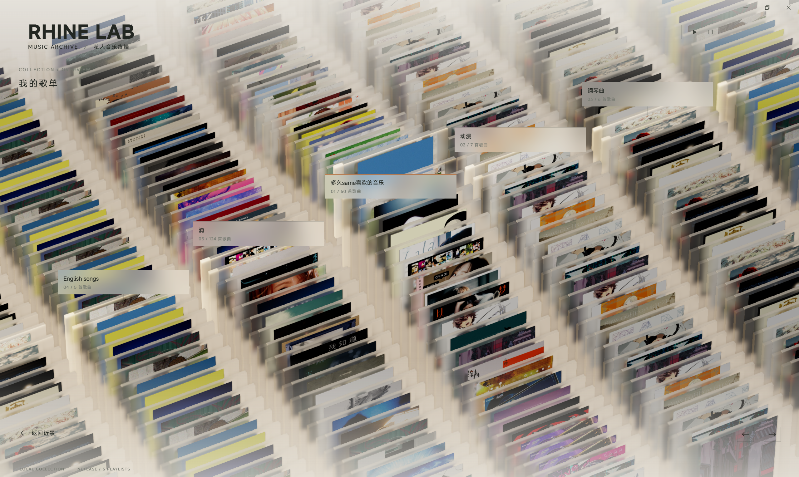
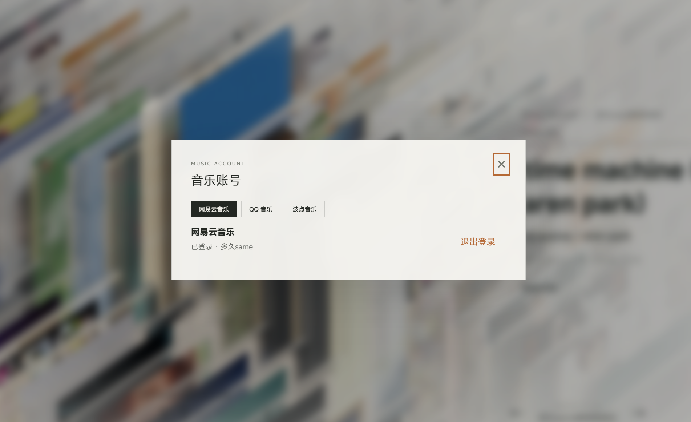
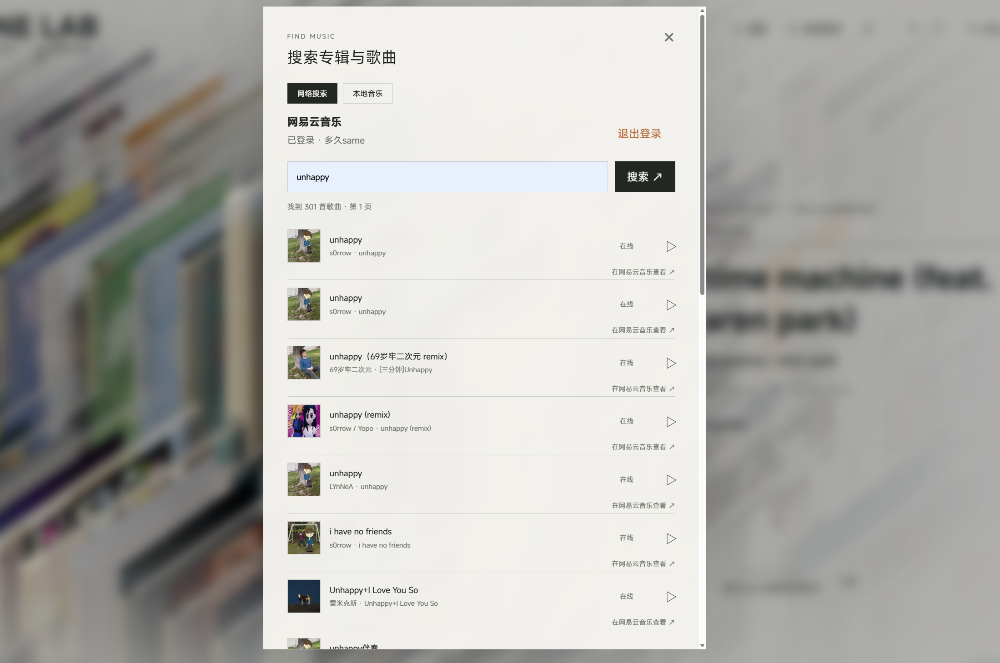

# Rhine Music · Windows

把音乐放进三维玻璃专辑架，浏览自己的收藏。

这是 [RonaldDeng/Rhine-Music-Demo](https://github.com/RonaldDeng/Rhine-Music-Demo) V0.4.1 的 **Windows 社区衍生版**，由 [DuoJiuBetter](https://github.com/DuoJiuBetter) 独立维护；视觉与渲染基础来自 [LBEILC/RhineLabUI](https://github.com/LBEILC/RhineLabUI)。本仓库与上游作者、音乐平台及原作品牌方没有官方合作关系。

[下载 Windows 预览版](https://github.com/DuoJiuBetter/Rhine-Music-Windows/releases) · [使用说明](README.windows.md) · [第三方平台与权利说明](PLATFORM-NOTICE.md) · [隐私说明](PRIVACY.md) · [版权与资源来源](NOTICE.md)

## 当前版本

**0.1.0 Preview · 基于 0.4.1-perf21**，Windows x64。它仍是开发预览版，第三方登录、接口可用性与不同显卡表现会随平台、驱动、网络和账号权限变化。尚未进行完整实机兼容性验收，不承诺所有电脑达到固定帧率。

- Tauri + WebView2 桌面窗口，顶部拖动、透明窗口控件、最大化保留任务栏。
- 三维玻璃专辑架、暖昼／深夜主题、景深与独立清晰封面；可见范围裁剪、玻璃深度遮挡优化、分辨率预算和封面分帧上传。
- 根据实际渲染显卡选择默认画质，优先请求可用独显，也可手动选择画质；最终 GPU 选择由 Windows 和驱动决定。
- 本地音乐库；可登录网易云音乐、QQ 音乐或波点音乐，在当前平台曲库中搜索，并读取该账号可访问的歌单。平台返回的音源和账号权限决定能否播放完整歌曲或试听片段。
- 歌单总览、抽屉曲目列表、循环浏览、歌曲详情、歌词滚动与点击定位、播放进度。
- 全窗口分类设置；详细报错默认关闭，可在开发者设置开启；反馈邮件草稿自动带入经过过滤的诊断。
- 网易云 API 使用独立 IPv4 连接池，并保留 TLS 校验、请求上限、超时及有限重试。

### 登录音乐平台，搜索曲库并浏览歌单

通过右上角“登录”选择网易云音乐、QQ 音乐或波点音乐。登录确认后，网络搜索会跟随当前平台切换；“我的歌单”读取该账号在对应平台可访问的歌单，选中歌曲后按平台实际返回的音源播放。登录成功不代表所有歌曲都能完整播放，片段、会员／地区权限、接口变化及平台风控都可能影响结果。

**歌单总览**：以三维专辑架浏览账号中的歌单和歌曲。



**音乐账号**：在网易云音乐、QQ 音乐和波点音乐之间选择登录平台。



**网络搜索**：搜索当前登录平台的曲库，查看平台返回的歌曲和可用音源。



根据酷狗公开的[用户服务协议](https://m.kugou.com/html/agreement.html)，未经合法授权使用第三方工具或服务接入其软件及相关系统受到限制。本项目没有采用这类非官方接入方式，也未集成酷狗的[官方曲库开放组件](https://open.kugou.com/docs/open-player/)，因此当前版本不提供酷狗账号登录、曲库搜索或个人歌单读取功能。维护者仅依据公开文档作出这一实现选择，未与酷狗方面沟通。更多平台边界见 [第三方平台与权利说明](PLATFORM-NOTICE.md)。

操作界面截图与功能说明见 [在线音乐与平台登录](docs/WINDOWS-ONLINE-MUSIC.md)。

## 下载与使用

从本仓库 [Releases](https://github.com/DuoJiuBetter/Rhine-Music-Windows/releases) 下载标有 **Public / x64** 的便携 ZIP，完整解压后双击 `Rhine Music.exe`。必须保留旁边整个 `runtime` 目录。自带 Node.js，无需自行安装 Node.js、npm 或 Rust；需要微软 [WebView2 Runtime](https://developer.microsoft.com/microsoft-edge/webview2/)。EXE 尚未签名。

首个公开包**不捆绑 FFmpeg / ffprobe**。WebView2 能解码的格式可尝试直接播放；APE、部分 DSD 等格式以及部分无缝播放路线需要用户另行安装合适的 FFmpeg / ffprobe。可通过 `FFMPEG_PATH`、`FFPROBE_PATH` 指定其绝对路径；具体支持取决于编码与解码器。在线歌曲能否播放、完整播放或试听由平台返回结果和账号权限决定。

本地音乐目录在“设置 → 本地歌单设置”添加。在线账号通过右上角“登录”选择平台；搜索和“我的歌单”随当前平台切换。没有曲库或队列时展示空白模型。

## 隐私与反馈

音乐文件与标签只读。Windows 用户数据位于 `%LOCALAPPDATA%\local.rhine.music.windows\music-data`；登录会话使用当前 Windows 用户的 DPAPI 分平台加密保存，不包含在下载包中。网络请求会向对应平台发送执行功能所需的登录凭据和查询信息，详情见 [PRIVACY.md](PRIVACY.md)。

反馈邮箱：**2228396737@qq.com**。设置中的反馈功能生成邮件草稿，发送前请检查；不会自动发送。请勿公开 Cookie、登录令牌、扫码授权信息、私人歌单导出或原始网络抓包。详细诊断可复制／保存，但仍应先检查自行填写的说明。

涉及版权、商标、账号接入或平台协议的问题，也请联系此邮箱并提供具体文件／功能、权利依据和必要说明。维护者会及时核实，并视情况停止相关适配、删除相关内容或下架受影响版本。**免责声明不构成平台授权，也不免除依法应承担的责任。**

## 从源码构建

需要 Windows x64、Node.js ≥ 22.12.0、Python 3（导出公开 ZIP）、Rust stable、Visual Studio C++ 构建工具及 Windows SDK。使用锁文件安装依赖：

```powershell
npm ci
npm run build
npm run desktop:build
```

`desktop:build` 会通过 Tauri 的 beforeBuild 再准备网页和运行时，产物放在 `release/Rhine-Music-Windows`。生成公开便携包请使用：

```powershell
node scripts/build-public-native.mjs
node scripts/package-public-release.mjs release/Rhine-Music-Windows
```

请在 Visual Studio x64 Developer 终端运行公开宿主构建；它在独立 target-public 目录编译并映射构建机路径。打包步骤创建独立的 `release/Rhine-Music-Windows-Perf21-Public` 和 ZIP，不修改输入包；排除可选 FFmpeg 二进制，补入公开说明、依赖许可和 SHA-256 清单，同时导出已提交的源码快照。不能只修改版本名就将旧二进制视为新版本。

## 验证与版本管理

Perf21 已完成类型／语法检查、生产构建、锁定依赖的原生编译及便携包静态一致性校验。本次公开发布沿用 Perf21 网页和服务代码，补齐文档、许可及打包材料；原生宿主重新编译以去掉编译机路径和发行版的开发目录回退，并补齐反馈命令的显式权限；**没有重新运行播放器、WebView、GPU、音频或平台账号回归**。验证范围见 [Perf21](docs/WINDOWS-PERF21.md) 和 [验收记录](docs/WINDOWS-VALIDATION.md)，历史记录不代表当前版本的完整验收。

公开分支保留上游 Git 历史，Windows 版本以独立提交及预览标签管理。原开发工作区的完整历史与旧包保留用于回退；公开初始移植提交对应 Perf21 源码快照，不公开本机诊断文件、私人数据或开发机目录。

## 许可与致谢

有权授权的程序代码、脚本和技术文档采用 [MIT License](LICENSE)，保留 **LBEILC**、**RonaldDeng** 的署名；Windows 修改由 DuoJiuBetter 维护。MiSans、第三方依赖、模型、标志、《明日方舟》相关视觉元素及声音采样各自遵循其权利边界，不能一概视为 MIT 或已获商业授权。请先阅读 [NOTICE.md](NOTICE.md) 和 [PLATFORM-NOTICE.md](PLATFORM-NOTICE.md)。

[README.upstream.md](README.upstream.md) 保留 RonaldDeng 的原说明，[README.original.md](README.original.md) 保留更早的 RhineLabUI 原说明；其中主线支持、下载链接与维护政策属于各自上游的语境。
